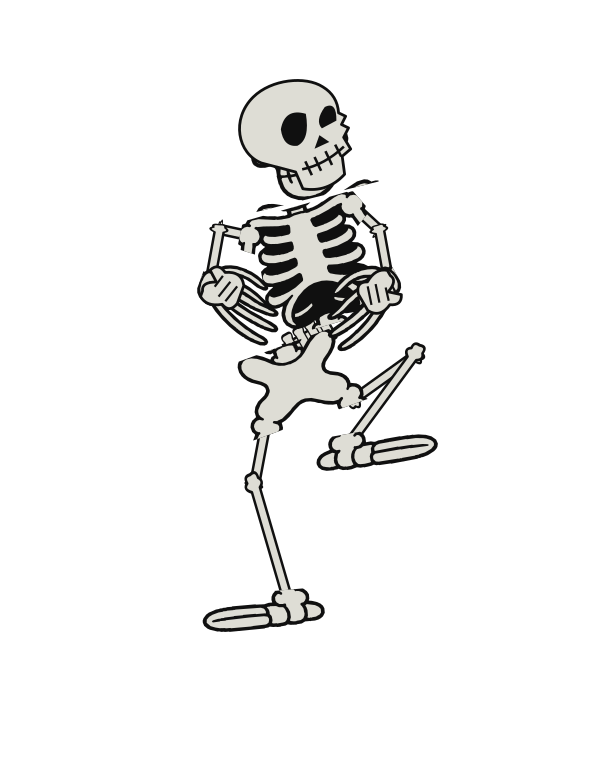

# Un esqueleto reutilizable: SVG + PNG con transparencia

Esta entrega contiene **un único personaje independiente del escenario**.
No reproduce el vídeo ni incrusta fotogramas dentro del SVG.

## Qué contiene

- `skeleton.svg`: personaje estático, hecho de trazados vectoriales.
- `skeleton-animated.svg`: coreografía completa en SVG autónomo, animada con SMIL.
- `skeleton-rhombus.svg`: secuencia corta de rombo y estiramiento.
- `poses/0000.svg`–`0659.svg`: 660 poses vectoriales autocontenidas y transparentes.
- `png/0000.png`–`0659.png`: las mismas 660 poses en RGBA, 600×760 píxeles.
- `reference-clean.png`: figura frontal limpiada/redibujada sobre transparencia.
- `spritesheets/`: 11 atlas PNG transparentes y sus coordenadas JSON compatibles
  con el formato de TexturePacker; cada celda mide 200×254 y todos los atlas
  juntos contienen las 660 poses en orden. Los PNG individuales conservan 600×760.
- `motion.mjs`: 44 poses clave editables, secuencias e interpolación.
- `keyframes.json`: los mismos datos en un formato independiente de JavaScript.
- `skeleton.mjs`: dibujo por partes y API para controlar el personaje.
- `art.json`: trazados del personaje. No contiene píxeles ni base64.
- `index.html`: estudio interactivo para probar y descargar las poses.
- `skeleton-poses.zip`: paquete de SVG y PNG, sin escenario ni vídeos.

Los SVG estáticos y animados se pueden abrir directamente. El estudio y los módulos
JavaScript requieren un servidor HTTP; desde la raíz del proyecto: `npm start`.
No necesitan dependencias de frontend, Internet ni acceso a YouTube.

## Procedencia y límites de fidelidad

Referencia: el corte de The Skeleton Dance que compartió el usuario, correspondiente
a 02:38–03:00 del vídeo. Se inspeccionó un mismo esqueleto en 44 instantes separados
por 15 fotogramas. La figura frontal se limpió/redibujó con generación de imagen y se
trazó a dos colores. Cabeza lateral, manos cerradas, columna y huesos articulados se
reconstruyeron en vector. Cabeza, pecho, pelvis, brazos, manos, piernas y pies se
controlan de manera independiente.

**Las 660 poses no son 660 calcos ni máscaras exactas del original.** Son muestras
de una reconstrucción articulada a partir de 44 poses clave colocadas manualmente;
las intermedias se interpolan. Conservan los motivos del baile, pero la forma y la
coreografía presentan aproximaciones. Los PNG son exportaciones de ese mismo dibujo
vectorial, no recortes de la película. El fondo y el resto de los personajes no
aparecen en los recursos finales. El alfa es real, no una cuadrícula dibujada.

La animación completa dura 22,022 segundos, con 660 muestras a 30000/1001 fps.
La última pose y la primera corresponden a un corte; el bucle completo no pretende
una transición continua. La secuencia corta de rombo sirve como ciclo reutilizable.
Los cambios entre cabeza frontal/lateral y manos abiertas/cerradas son discretos.

## Usar sin programar

```html

```

En un editor de vídeo o animación, importa `png/` como secuencia de imágenes a
**29,97 fps**, conservando el canal alfa. Todos los PNG tienen el mismo lienzo y
punto de referencia; no están recortados al contenido de cada pose.

Para editar en Inkscape/Illustrator: abre un SVG de `poses/`. Las partes son grupos
con identificadores `data-part`. Algunas usan trazados compartidos y recortes SVG:
puedes liberar el recorte o desvincular el clon para editar los trazados individuales.
No se usan fuentes ni recursos externos en los SVG exportados.

## Controlar desde JavaScript

```html
<svg id="actor" viewBox="0 0 600 760" width="300"></svg>
<script type="module">
  import { Skeleton } from './skeleton.mjs';
  const art = await fetch('./art.json').then(r => r.json());
  const actor = new Skeleton(document.querySelector('#actor'), art);
  actor.play({ start: 60, end: 135, rate: 1 });
  // actor.pause();
  // actor.setFrame(120);
  // actor.setTime(4);
  // actor.destroy();
</script>
```

Para cambiar los colores en un SVG insertado directamente en HTML:

```css
#actor { --bone: #deddd5; --ink: #101010; }
```

El estudio también permite cambiar colores y descargar un SVG o PNG con esos
colores. El botón de SVG animado exporta la secuencia seleccionada. Los fondos
claro, oscuro y violeta sirven únicamente para probar el contraste: nunca se
incluyen en los archivos descargados.

## Cambiar la coreografía

Edita las posiciones de cabeza, pecho, pelvis y articulaciones en `motion.mjs`.
Las coordenadas se expresan en un lienzo común de 600×760. `sample(frame)` devuelve
la pose interpolada. Los datos originales de las 44 poses están en `KEYFRAMES`.

Para regenerar SVG y datos:

```sh
node character/export.mjs
```

Para regenerar PNG con el servidor de desarrollo en el puerto 8000:

```sh
python3 character/export_png.py
```

Para verificar la interfaz y los SVG:

```sh
python3 character/check.py
```

La exportación y comprobación usan Chromium, Playwright y Pillow de esta máquina;
el uso del personaje en una web no depende de ellos. `vectorize.py` es una utilidad
opcional de trazado del PNG de referencia y requiere NumPy y Matplotlib. No hay que
volver a trazar ni acceder a servicios de generación para utilizar la biblioteca.
